<div align="center">

# 11Planner

**Stop scrambling at 11:59. Actually plan your week.**

[](https://nextjs.org)
[](https://react.dev)
[](https://fastapi.tiangolo.com)
[](https://python.org)
[](https://supabase.com)
[](https://typescriptlang.org)
[](https://opensource.org/licenses/MIT)

**[🚀 Live Demo](https://my11planner.vercel.app)** &nbsp;·&nbsp; **[📖 How to Run](./RUN_INSTRUCTIONS.md)** &nbsp;·&nbsp; **[📋 User Manual](./USER_MANUAL.md)**

</div>

---

We built 11Planner because we were tired of the same cycle — knowing a project was due, not knowing when to actually work on it, and ending up doing it the night before. Most students aren't bad at school, they're just bad at planning. So we made something that does it for you.

You put in your courses and tasks. 11Planner figures out when you should work on them, breaks everything into manageable chunks, and builds you a real schedule — one that fits around your actual life.

---

## What it does

**Schedule generation that's actually smart**
Not just a to-do list. The backend looks at every task you have, ranks them by how urgent they are (deadline vs. how long it'll take), and fills your week with focused study blocks. It avoids your class times, stays within your daily hour limit, and adds breaks between sessions. You can regenerate the schedule anytime something changes.

**Courses + syllabus upload**
Add your courses manually, or just drop the PDF syllabus and let it pull out the course name, code, professor, and meeting times automatically. Less copy-pasting.

**Task tracking that actually connects to your schedule**
Tasks link to courses. You set the deadline, estimated hours, and priority. The schedule generator uses all of that. When you mark something done, it's gone from the plan.

**Four calendar views**
Day, Week, Month, Year. Switch between them whenever. Blocks are color-coded by priority so you can tell at a glance what needs attention first.

**A dashboard you actually want to open**
Built-in Pomodoro timer. 30 looping video backgrounds across five categories (Nature, Anime, Cafe, City, Abstract). Seven ambient sounds. You can go full focus mode and hide the entire UI — just you, the timer, and the background.

**Canvas sync via Chrome extension**
If you're on Canvas, there's a Chrome extension that grabs your assignments and imports them into 11Planner automatically. No more manually copying every due date.

**Notifications that don't spam you**
You control how far in advance you get reminded — anywhere from 1 to 168 hours before a deadline. Push notifications and weekly email summaries if you want them.

**Themes and settings**
Light, Dark, or Auto. Six color accents. Your daily study cap (1–12 hours). Everything saves to your account so it's the same on every device.

---

## How it works

```
Add your courses → Add your tasks → Generate schedule → Study
```

That's really it. The scheduling algorithm handles urgency scoring, break spacing, daily limits, and class conflicts behind the scenes. You just tell it what you have to do and when it's due.

---

## Screenshots

> To add real screenshots: take them, save them to `docs/screenshots/`, and update the paths below.

### Landing Page
The first thing you see when you open 11Planner. Explains what it does, has a sign-up/login button, and shows the "11" branding with the story behind the name.

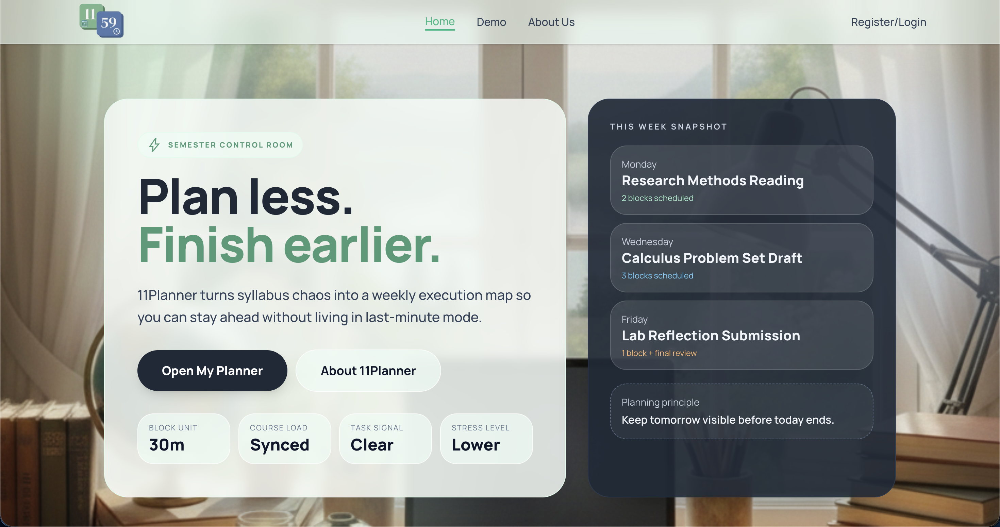

---

### Dashboard
The main hub once you're logged in. Shows your upcoming deadlines, a breakdown of pending vs. completed tasks, quick-action buttons (Add Task, Add Course, View Schedule), and the Focus Dashboard panel at the bottom.

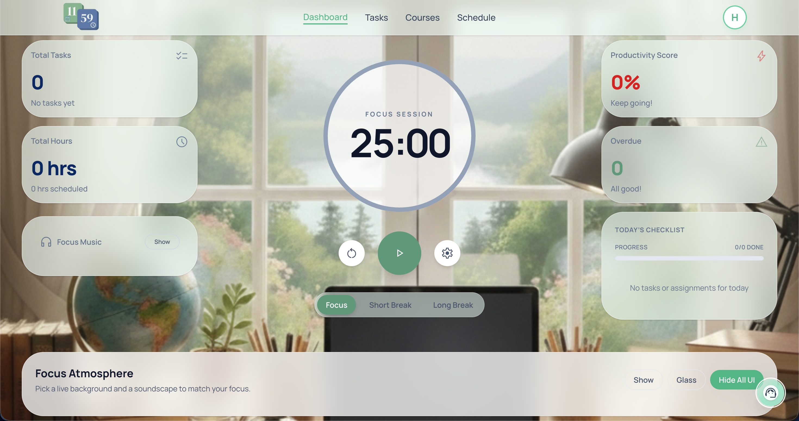

---

### Focus Mode — Dashboard
The dashboard with a video background active and the Pomodoro timer running. Shows the three UI modes: standard, glass panels (transparent), and the full hide-all-UI mode where everything except the timer disappears.

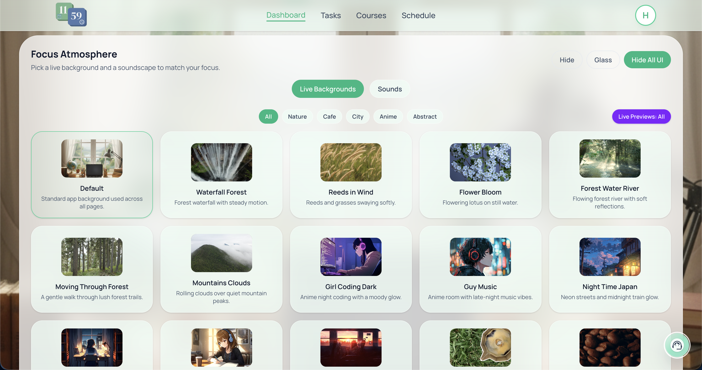

---

### Tasks Page
Your full task list sorted by deadline. Shows the priority color coding (red = high, yellow = medium, blue = normal), the complete/in-progress toggle, and the "New Task" form on the right with the course dropdown, deadline picker, estimated hours, and priority slider.

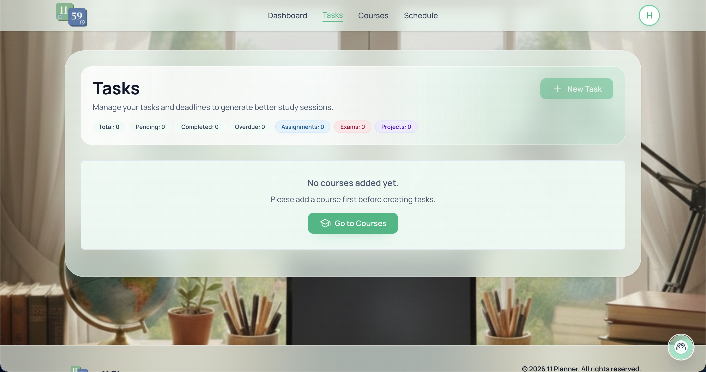

---

### Courses Page
All your added courses shown as cards. Each card shows the course name, code, professor, and meeting days/times. The "Add Course" panel on the right has the syllabus PDF upload zone — drag a PDF in and the fields fill themselves.

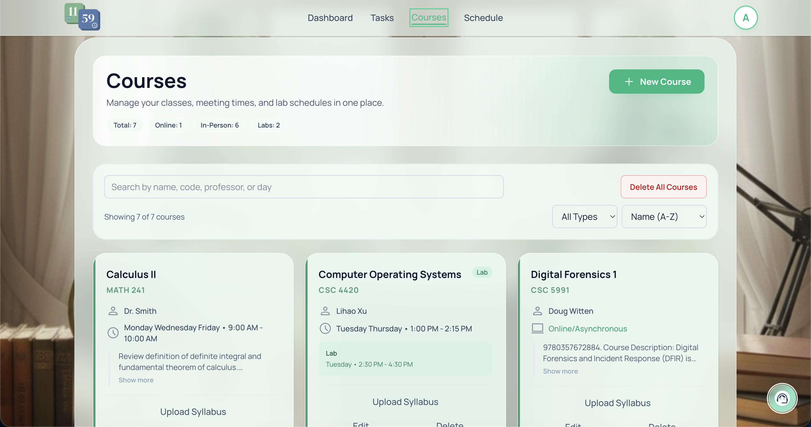

---

### Schedule — Week View
The generated schedule in week view. Color-coded blocks for class times (from courses), study blocks (from schedule generation), and break blocks. Shows how tasks are distributed across the week without overlapping classes.

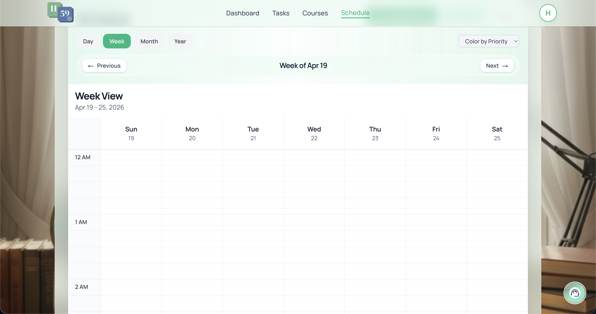

---

### Schedule — Day View
Zoomed into a single day. Shows the hourly breakdown with each study block's task name, estimated duration, and priority. You can drag blocks to different time slots directly from this view.

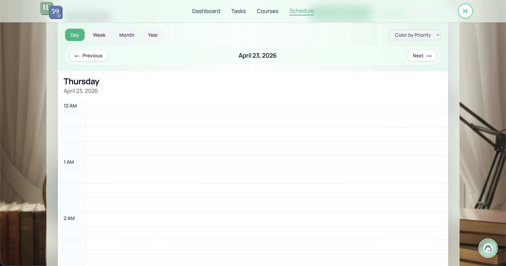

---

### Schedule — Month View
Full month calendar. Shows which days have study blocks scheduled, how many, and which are highest priority. Good for getting a sense of how heavy a week looks ahead of time.

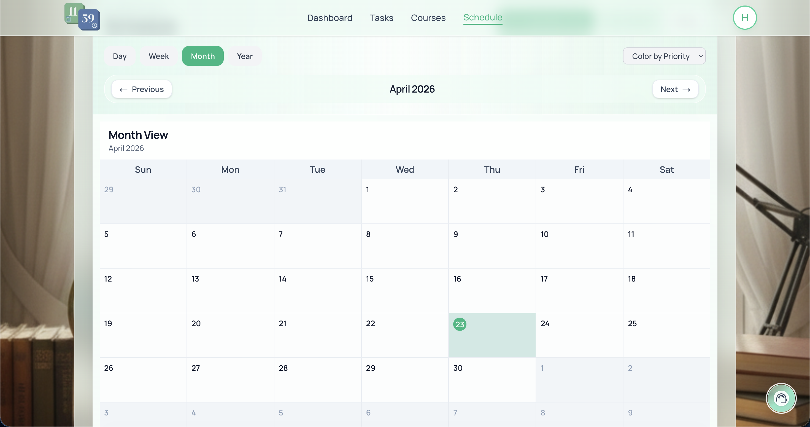

---

### Profile & Preferences
Where you set your study preferences — which days you're available, what time of day you prefer to work, your work style (steady vs. crunch), and how you like to approach assignments. These feed directly into the schedule generator.

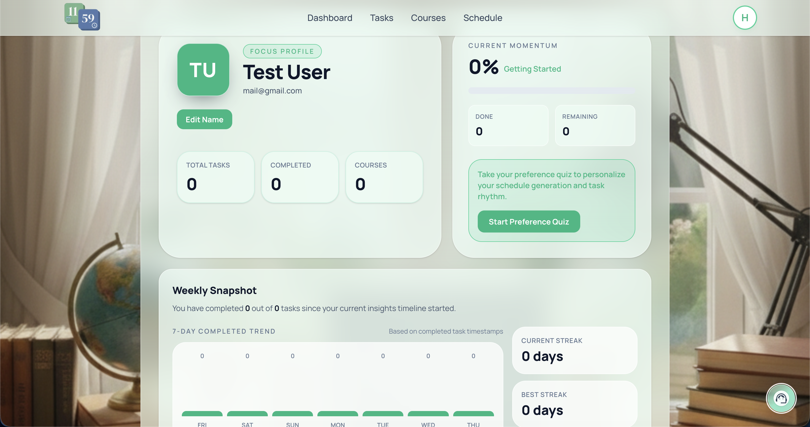

---

### Settings Page
Theme switcher (Light/Dark/Auto), color accent selector, daily study hour cap slider, notification toggle and lead-time selector, and timer duration settings. Every setting syncs to your Supabase profile.

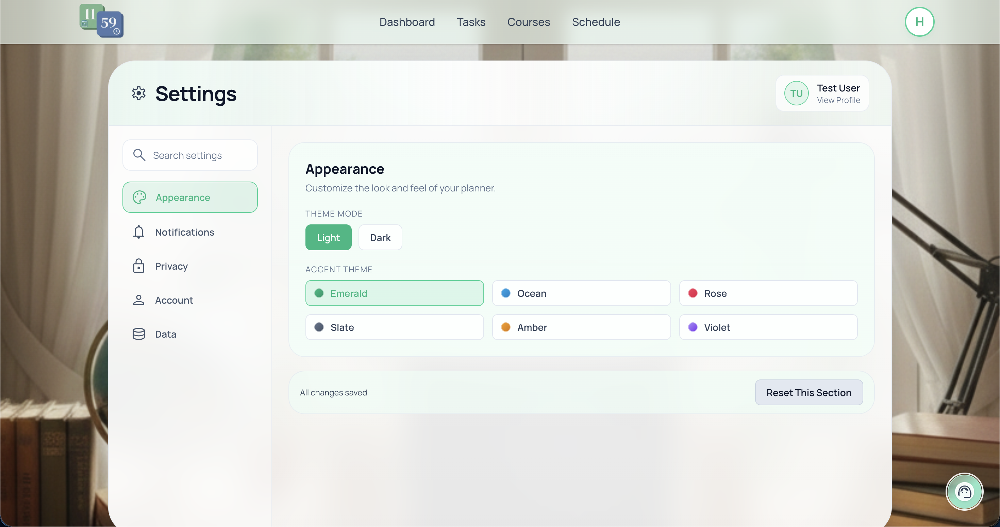

---

### Canvas Chrome Extension
The extension popup on a Canvas course page. Shows the "Sync to 11Planner" button, the list of detected assignments with their due dates, and a status indicator showing how many were successfully imported.

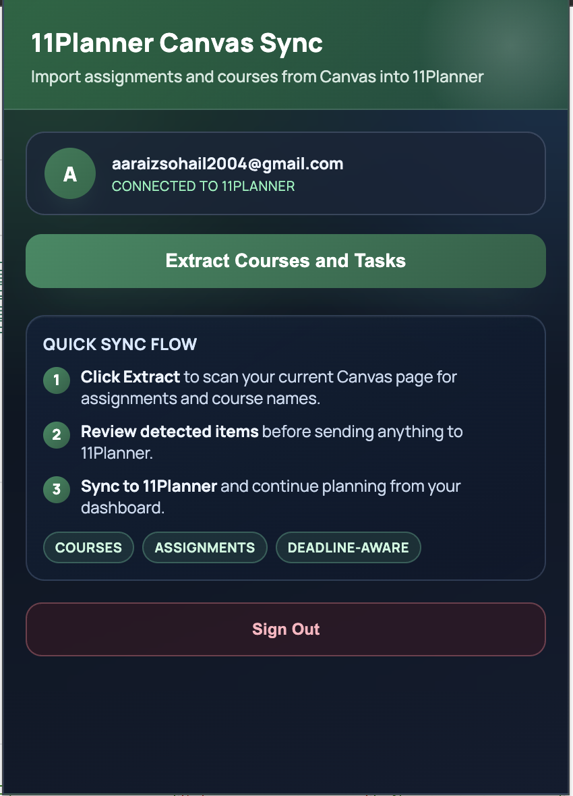

---

## Tech stack

| | |
|---|---|
| Frontend | Next.js 16, React 19, TypeScript, Tailwind CSS v4 |
| Backend | Python 3.11+, FastAPI |
| Database & Auth | Supabase (PostgreSQL + Row-Level Security) |
| AI | OpenAI (schedule optimization), Google Gemini (syllabus parsing) |
| PDF | pypdf |
| Extension | Chrome Manifest V3 |
| Deployed on | Vercel (frontend) + Render (backend) |

Both AI keys are optional. Without them, scheduling still works using urgency-based scoring and regex syllabus extraction.

---

## Project structure

```
11Planner/
├── backend/
│   ├── app/
│   │   ├── main.py                  # FastAPI entry point
│   │   ├── schedule_generator.py    # The actual scheduling logic
│   │   ├── syllabus_parser.py       # PDF parsing
│   │   ├── ai_task_estimator.py     # Time estimation
│   │   ├── models.py                # Pydantic models
│   │   └── api/                     # Route files (tasks, assignments, schedule blocks, email, etc.)
│   └── requirements.txt
├── frontend/
│   └── src/
│       ├── app/                     # Pages: dashboard, tasks, courses, schedule, profile, settings
│       ├── components/              # ScheduleView, Timer, Navigation, FocusDashboardPanel, etc.
│       ├── contexts/                # PlannerContext, ThemeContext, TimerContext, MusicContext
│       ├── lib/                     # Supabase client + API helpers
│       ├── types/                   # Shared TypeScript types
│       └── utils/                   # Date helpers, ICS export
├── canvas-extension/                # Chrome extension for Canvas sync
├── RUN_INSTRUCTIONS.md
└── USER_MANUAL.md
```

---

## Running it locally

Full setup guide is in **[RUN_INSTRUCTIONS.md](./RUN_INSTRUCTIONS.md)**. Short version:

```bash
# Terminal 1 — backend
cd backend
cp .env.example .env        # add your keys
python -m venv .venv && .venv\Scripts\activate
pip install -r requirements.txt
uvicorn app.main:app --reload

# Terminal 2 — frontend
cd frontend
# create .env.local (see below)
npm install && npm run dev
```

Then go to `http://localhost:3000`.

---

## Environment variables

**`backend/.env`**
```
SUPABASE_URL=
SUPABASE_KEY=
OPENAI_API_KEY=       # optional
GEMINI_API_KEY=       # optional
```

**`frontend/.env.local`**
```
NEXT_PUBLIC_SUPABASE_URL=
NEXT_PUBLIC_SUPABASE_ANON_KEY=
NEXT_PUBLIC_API_URL=http://localhost:8000
```

---

## The team

We're four CS seniors at Wayne State who built this for our capstone. We all use it now.

| | |
|---|---|
| Tamana Gaur | Team lead, documentation |
| Suganeshwara Anand | Frontend, scheduling engine, UX |
| Ayham Huq | Backend, APIs |
| Aaraiz Sohail | Deployment, QA |

**Wayne State University — CSC 4996, 2026**

---

<div align="center">
Built by students, for students. Made with a lot of coffee and a few too many late nights.
</div>
